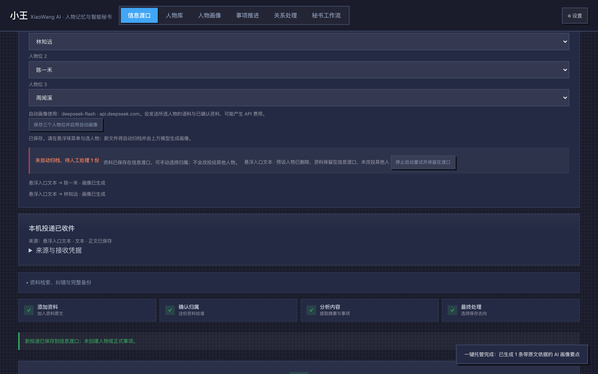
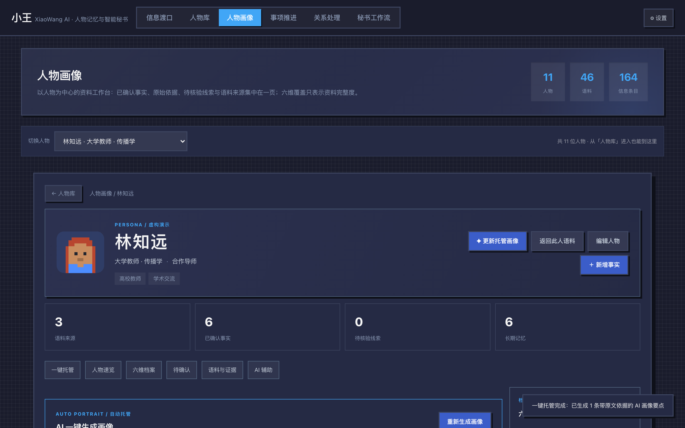
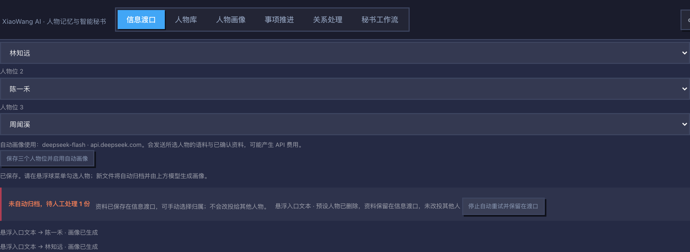
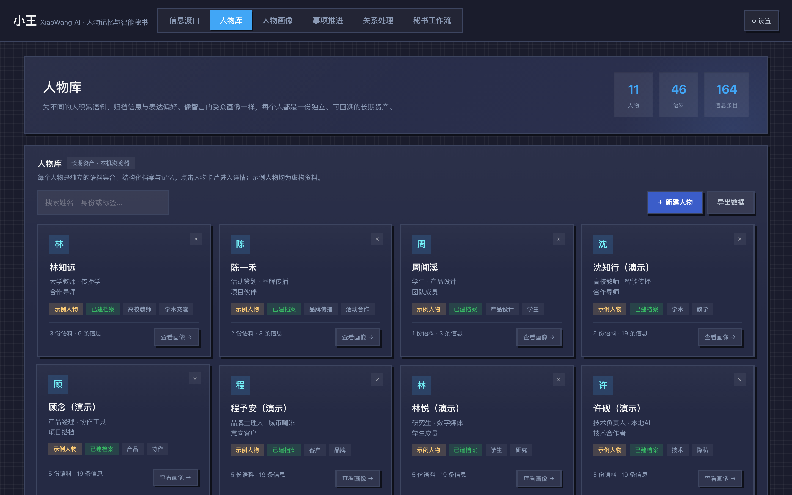
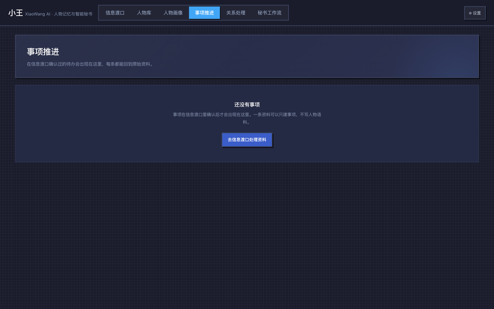
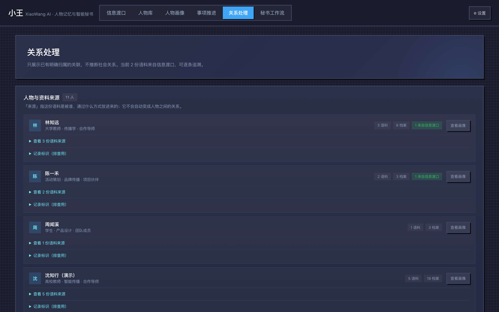
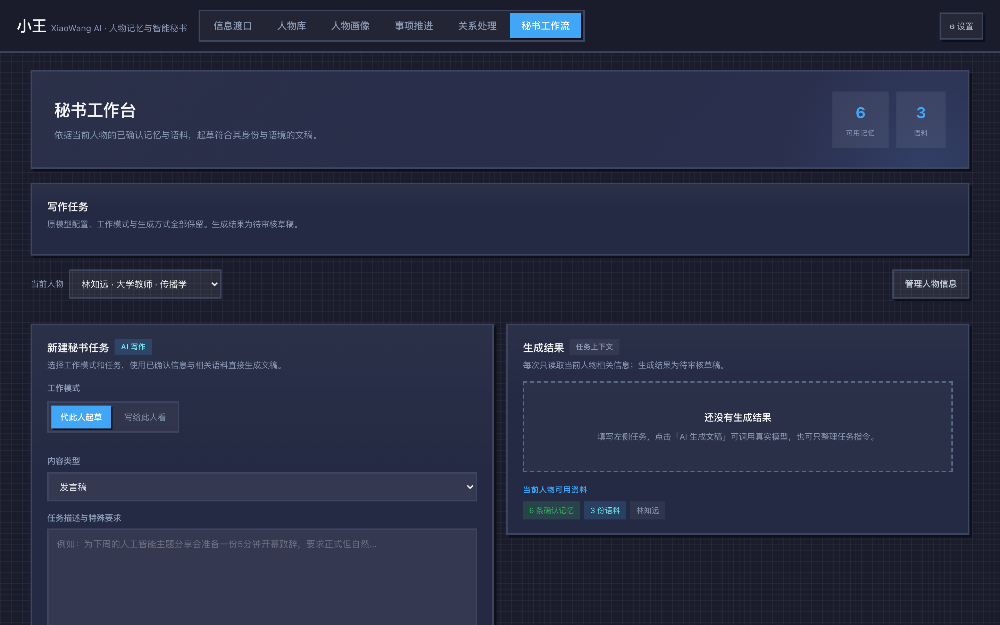
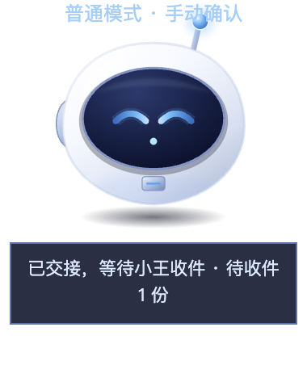

# 小王 XiaoWang AI · 人物记忆与智能秘书

> **一份资料进来，先确认它主要归给谁，再看内容，最后决定保存在哪里。**
>
> *A local-first personal memory workspace. Files dropped on a desktop companion are bound to a specific person at creation time, archived transactionally, and turned into an evidence-cited profile — never silently re-attributed to someone else.*

<p align="center">
  <a href="https://xiaowang-ai-memory.app.workbuddy.host/?sharecode=CJZIJV4FEN"></a>
  
  
  
</p>

<p align="center">
  
</p>

---

## 1. 问题：AI 不缺对话框，缺的是「这份资料属于谁」

通用 AI 助手能读文件、能总结，但放在真实生活里会卡在三件事上：

| 真实处境 | 通用助手的表现 |
|---|---|
| 拖进来一份资料，是同事的、朋友的、还是家人的？ | 一次性上下文，下次全忘 |
| 同一批资料要同时服务三个人 | 全部混在一个对话里，互相污染 |
| 模型说的这句话，是从哪句原文推出来的？ | 只给结论，无法回溯 |
| 网络断了、页面被关了、人删了 | 文件丢了或重复处理，没人知道 |

小王把「**归属**」当成一等公民：资料在进入系统的**那一刻**就绑定人物、接收端和模型目标，之后所有归档、画像、重试都围绕这个已经固化的归属展开。

---

## 2. 产品形态：桌面悬浮球 + 本地服务 + 单文件工作台

```
┌──────────────────────┐        ┌───────────────────────┐        ┌────────────────────────┐
│  Electron 悬浮球      │  文件   │  Python 本地服务       │  事件   │  H5 工作台（单 HTML）   │
│  （常驻桌面，拖入即投）│ ─────▶ │  127.0.0.1:8915        │ ─────▶ │  信息渡口 / 人物库 …    │
│  普通模式 / 三个槽位   │ ◀───── │  SQLite 队列 + 事务    │ ◀───── │  事务归档 + 托管画像     │
└──────────────────────┘  ACK   └───────────────────────┘  轮询   └────────────────────────┘
```

- **悬浮球**：真的系统级 Electron 窗口（不是网页挂件），拖文件、选人物、看状态。退出后可从页面重新拉起，隐藏了能找回。
- **本地服务**：只用 Python 标准库（`http.server` + `sqlite3`），回环地址 + 三角色 token，负责排队、幂等、ACK。
- **工作台**：一个 595 KB 的单 HTML（无前端框架、无 CDN、无构建工具链依赖），六大导航：信息渡口、人物库、人物画像、事项推进、关系处理、秘书工作流。

> 三段式的好处：**采集**（桌面）和**判断**（浏览器 UI）和**持久化**（服务）各自独立。关掉悬浮球不丢队列，关掉浏览器不影响接收，服务离线时文件留在本地待投递清单里。

---

## 3. 三个有区分度的设计

### 3.1 归属固化在事件里，而不是「当前选择」里

投递时把 `person_id / receiver_id / model_stamp` 写进事件；切换槽位只影响**之后**的投递。已在队列里的旧资料不会因为手滑换人就改投别人——这是最容易被忽略、也最容易造成真实伤害的 bug。

### 3.2 三个人物位 + 普通模式，而不是「多开几个 AI 人格」

三个槽位直接复用**既有人物库**（不新建第二套人物数据），可以随时更换；普通模式保留原来的「人工确认」路径。同一时刻只归档到一个人，菜单里一次勾选一人。

### 3.3 画像必须带原文证据，且 AI 推断不等于事实

托管画像沿用既有的六维算法，但强制：

- 每条洞察带 `sourceId + quote`，指向具体某份资料的某段原文；
- 明确标注「AI 推断」，不写成已确认事实；
- 失败**不吞**：文件保留、ACK 保留、画像单独显示失败并可单条重试。

<p align="center">
  
</p>

---

## 4. 异常路径是被设计过的，不是被兜住的

这是本项目投入最多的地方。每一种「不顺利」都有明确归宿，且**单份异常不会阻断其他投递**：

| 异常 | 系统行为 |
|---|---|
| 目标人物已被删除 | 不创建替代人物、不改投他人；资料保留在渡口，归入「待人工处理」 |
| 正文提取失败 / 只提取到一部分 | 标注原因，等待人工核对，不自动归档 |
| 换了浏览器或清了站点数据 | 面板直接提示「不是同一份浏览器资料」，保存前二次确认，取消则不动原配置 |
| 画像生成时页面被关掉 | 下次打开用 `navigator.locks.query()` 检测锁无人持有，自动重新排队 |
| 两个标签页同时轮询同一份投递 | 乐观校验冲突后自动重载并重试，不再停摆 |
| 想放弃某份异常资料 | 「停止自动重试并保留在渡口」：补一条 ACK 退出队列，资料仍在、归属仍空，可手动选人 |
| 服务离线 | 保留待投递文件与所选人物，服务重开后重新配对继续 |
| 重复投递同一事件 | 幂等：不重复归档、不重复调用画像模型 |

<p align="center">
  
</p>

---

## 5. 安全与隐私边界（本地优先的硬约束）

- 服务**只监听 `127.0.0.1`**，不对局域网开放；校验 `Host`、`Origin` 与配对 token。
- 三种角色 token 分离：`desktop` / `h5` / `manager`，越权调用返回 401/403。
- 网页只能向服务传 `visible` 布尔值，**不能指定程序路径或启动参数**——不开放「任意网页启动任意程序」。
- 模型密钥只存在你自己的浏览器 `localStorage`，不写入队列、不发给悬浮程序。
- 浏览器数据按 origin 与浏览器隔离：不做跨浏览器迁移、不读取他人浏览器资料。

---

## 6. 技术栈与代码地图

| 层 | 技术 | 入口 |
|---|---|---|
| 桌面入口 | Electron（原生窗口、拖拽、托盘菜单、IPC） | `Electron悬浮入口/main.js`、`pet.html`、`transport.js` |
| 本地服务 | Python 3 标准库：`http.server` + `sqlite3` + `hmac` | `Windows本地服务/本地投递服务.py`（目录名为兼容旧版保留，本副本跑在 macOS） |
| 工作台 | 原生 JS，无框架；单 HTML 由脚本从基线拼装 | `源码/build.py` → `小王M1.1_桌面联动.html` |
| 业务逻辑 | 事务归档、画像调度、人物/事项/关系模型 | `源码/processing.js`、`源码/app.js` |
| 自动化测试 | Playwright（含真实 Electron）+ `unittest` | `测试/` |

规模：核心 JS/Python 约 2.4k 行，工作台构建产物 595 KB（含基线样式与内容）。

```
源码/            app.js · processing.js · presets-ui.js · delivery-ui.js · receiver-ui.js
                memory-core.js · build.py · baseline.html（构建基线）
Electron悬浮入口/ main.js · pet.html · composer.html · transport.js · preload.js
Windows本地服务/ 本地投递服务.py
测试/            11 项主流程 · 8 项异常路径补测 · 服务回归 · 桌面重启 · 截图脚本
文档/            使用说明 · 改动与验收说明 · 测试日志 · 截图
```

---

## 7. 怎么跑起来（macOS）

前置：macOS、Python 3.11+、Node 22+、一份官方 Electron 运行时。

```bash
# 1) 构建单文件工作台（改源码后执行）
python3 源码/build.py

# 2) 启动：拉起本地服务 + 悬浮球 + 已配对的工作台页面
./打开小王.command          # 等价于 python3 运行Mac版.py
# 或双击 打开小王.command

# 3) 停止全部组件
./关闭小王组件.command
```

首次启动会在 `运行数据/` 下生成配对凭据与队列（已被 `.gitignore` 排除，不随代码分发）。页面地址固定为 `http://127.0.0.1:8915/小王.html`。

Electron 运行时的查找顺序：`运行数据/m11-runtime/electron-dist/…` → `/Applications/Electron.app` → `Electron悬浮入口/node_modules/electron/dist/…`；都没有时用环境变量指定：

```bash
XW_ELECTRON=/Applications/Electron.app/Contents/MacOS/Electron python3 运行Mac版.py
```

### 7.1 网页版（手机 / 任意浏览器直接打开）

同一份源码可以构建出纯静态网页版，无需安装、无需本机服务，手机浏览器直接可用：

```bash
python3 源码/build.py --web     # 产出 ../小王网页版/index.html（含 PWA 清单与离线兜底）
```

在线体验：<https://xiaowang-ai-memory.app.workbuddy.host/?sharecode=CJZIJV4FEN>
（作品介绍页：同域名 `/about.html`）

- **能在网页/手机上做什么**：信息渡口（粘贴文本、上传 Word/PDF/PPT，浏览器内解析）、人物库与语料、人物画像、事项推进、关系处理、秘书工作流、完整备份导出/导入。模型相关功能需在「设置」里填自己的 OpenAI 兼容 Key。
- **不能做什么**：桌面悬浮球的「拖进来就自动归档」需要本机 Electron + 本地服务，网页版没有这一段，投递面板会换成网页版说明；跨设备不会自动同步。
- **数据在哪**：`localStorage` + `IndexedDB`，按浏览器隔离，不上传任何服务器。换设备用「设置 → 导出全部数据」，在新设备「导入 JSON」。
- **离线**：注册了 Service Worker，首次打开后断网仍可进入（联网时始终取新版本）。
- **实现方式**：`build.py` 只对网页产物注入 `window.XW_WEB=true` 与 `源码/web-adapt.css`（移动端安全区、导航横滑、输入字号防缩放、`100dvh`）；桌面构建不含这些，行为完全不变。

---

## 8. 测试与证据

全部用例使用**隔离临时目录 + 全虚构人物与资料**，模型走**本地桩**（无外部 API 调用、无费用）。

| 套件 | 结果 |
|---|---|
| 人物预设主流程（含真实 Electron 文件交接、真实 ACK、离线恢复、人物删除保护、访问控制） | **11 / 11** |
| 异常路径补测（深链定位、待处理清单、停止重试、提取失败、换模型重试、中断恢复、跨标签页、跨浏览器） | **8 / 8**（连跑 5 次稳定） |
| 悬浮球设置入口地址断言 | **1 / 1** |
| 服务回归 `test_service.py` | **8 / 8** |
| 桌面退出/重开 `test_desktop_restart.py`（含连续三次 SIGTERM 重开） | **18 / 18** |
| **合计** | **46 / 46 通过** |

复现：

```bash
NODE_PATH=<playwright 所在 node_modules> \
XW_TEST_ELECTRON=<Electron 可执行文件> \
node 测试/person-presets.cjs        # 11 项主流程
node 测试/presets-followup.cjs      # 8 项异常路径
node 测试/presets-entry.cjs         # 入口地址断言

python3 -m unittest discover -s 测试 -p test_service.py -v
XW_TEST_ELECTRON=<Electron> python3 -m unittest discover -s 测试 -p test_desktop_restart.py -v
```

日志与结果文件见 `文档/`（`三个人物预设_接力后复测.log`、`接力补测.log`、`服务回归_接力后.log`、`*_测试结果.json`）。

---

## 9. 已知限制（如实说明）

1. **模型链路用本地桩验证**：画像成功/失败/换模型重试的**工程链路**已验证，但不代表真实模型的输出质量；本项目未调用任何真实外部 API，也未产生费用。
2. **无独立安装包**：当前依赖本机已有的 Electron 运行时，不是可分发的 `.app`／安装器。
3. **跨标签页并发**：已从「必然卡住」修到「自动自愈」，连跑 5 次未复现；未证明根因完全消除，极端情况下刷新任一页签即可恢复（资料与原件不会丢）。
4. **未做真实微信采集**：产品边界内不抓取聊天记录、不读浏览器个人资料、不迁移他人数据。
5. **原生菜单点击未自动化**：改为对打开地址的断言 + 页面侧深链用例；菜单项本身由人工验收。

---

## 10. 界面

| | |
|---|---|
|  |  |
| 信息渡口：资料先归位再入库 | 资料库：按人物沉淀长期语料 |
|  |  |
| 事项推进：从资料里长出来的待办 | 关系处理：人物之间的连接 |
|  |  |
| 秘书工作流：每日动作沉淀 | 桌面悬浮球：拖入即投，状态可见 |

---

## 授权与数据声明

- 本仓库不含任何运行数据、配对凭据、模型密钥、浏览器 profile 或第三方个人资料。
- 演示用人物（林知远、陈一禾、周闻溪）与全部测试资料均为**虚构**。
- 模型调用由使用者自行配置；密钥保存在使用者本机浏览器，不随代码分发。
