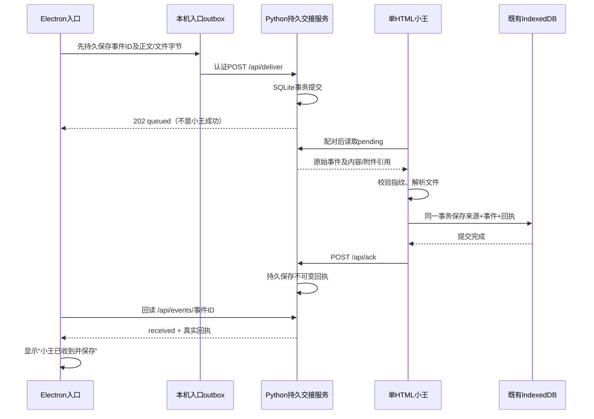

# 三组件通信契约 M1.1

## 进程与数据所有权

Electron是真实的操作系统窗口：透明、置顶、可移动，具备系统托盘、原生菜单和退出。它只有待投递缓存，不带人物/事项数据库。

Python仅负责传输队列、附件与回执，并静态提供同一份H5。SQLite `投递队列.sqlite3` 是交接记录，不是第二套小王业务库。

H5继续使用IndexedDB `xiaowang-h5-processing-v01` 版本1的 `sources/tasks`，人物主库仍为 `xiaowang-ui-v02-20261025`。没有改库名或把A演示库导入。



## 不可变来源事件

```json
{
  "schema":"xiaowang.delivery.event.v1",
  "event_id":"每次独立投递随机生成的UUID",
  "source_type":"desktop_text",
  "source_id":"原始来源的稳定标识，未知身份不冒认微信ID",
  "name":"资料名称",
  "captured_at":"带时区ISO时间",
  "occurred_at":null,
  "content":{"kind":"text","text":"原文"}
}
```

source_type当前支持 `desktop_text/desktop_file/shared_text/shared_file/synthetic_capture`。桌面选中文本需用户主动拖入或粘贴，不后台读取其他应用/剪贴板。原生文件入口将本机完整路径做SHA256生成稳定的opaque source_id，服务与H5不接收完整路径；文件名另外保留。文本无法识别原应用/人物时使用入口事件标识，不伪造聊天身份。未知原始发生时间为null，不用采集时间或文件mtime冒充消息发生时间。

文件content为 `{kind:'file',name,mime,size,sha256,base64}`。首次上传携带字节；服务核对尺寸、后缀、PDF/Office魔数和SHA256，存BLOB，公开事件对象去掉base64并保留文件引用 `GET /api/files/<event_id>`。不接收任意本机文件路径，不在服务器解压Office文件。

`payload_hash` = 对事件移除content.base64后的递归键排序JSON做UTF-8 SHA256。服务端、入口、H5均使用此规则。**同event_id同载荷**返回同记录；**同event_id不同载荷**返回409；**不同event_id即使正文相同**也保留独立记录。

H5为每个传输事件使用 `source.id='evt-'+event_id`。M1.0的普通手动文本去重保留；传输事件绕过按正文合并，因此独立事件有独立source记录。没有新建另一个人物/事项库。

## H5持久接收

现有source新增 `delivery:{event,payload_hash,accepted_at,receipt}`。原始事件及来源标识保留，正文继续放text，segments/warnings/parseStatus沿用M1.0。首次接收默认仅暂存渡口，不正式建人物、不建事项、不外发模型。

文件解析通过B原有解析器：ok/partial/failed明确展示。提取失败仍保留服务端原件引用，H5保存清楚的失败提示，不把它写成成功正文。收到附件与成功提取是两个状态。二进制原件保留在服务中，不内嵌H5备份；备份/移动整套交接数据需同时备份运行目录。

回执：

```json
{
  "receipt_id":"UUID",
  "event_id":"UUID",
  "payload_hash":"原事件SHA256",
  "source_record_id":"evt-UUID",
  "receiver_id":"本浏览器接收端标识",
  "received_at":"带时区ISO时间",
  "extraction_status":"text|ok|partial|failed"
}
```

只有IndexedDB事务完成，H5才发ACK。ACK网络失败或响应丢失时，本地source/receipt保持；重试返回原回执，服务接受相同回执重复提交，拒绝更换载荷/回执的请求。恢复备份也保留事件字段。

## 状态机与故障恢复

- 入口 `waiting-service`：已落盘，服务暂不可用；保留相同事件与文件字节，支持手动重试和退避重试。
- `waiting-h5`：服务已持久接受，尚无H5回执；禁止显示“小王已收到”。H5关闭时保持这个状态。
- `received`：回读到服务保存的真实H5回执。入口可以清除该文件的base64副本，保留事件元数据和回执。
- `conflict`：同ID载荷冲突，保留原记录，不用新ID掩盖冲突。
- 服务SQLite WAL + FULL同步；入口用临时文件、fsync、rename保存outbox。损坏入口记录时停止加载，保留原文，不自动重置空库。
- Python重启轮换配对凭证，不清队列；Electron每次请求重读自己的受限运行配置。H5需从入口重新打开配对链接；其原IDB数据保留。

## 认证与接口

本服务仅监听127.0.0.1，默认端口8915。同源提供H5；不输出任何通配CORS。严格Host、Origin/Fetch元数据及随机Bearer认证，拒绝null、其他网页和浏览器冒用native凭证。

三种角色分离：H5只读待接收正文/附件和写ACK；Electron投递及查自己已知事件回执；管理凭证只用于独立停止服务，撤销普通访问后仍可关闭。凭证保存在本机当前用户运行目录的 `本机配对.json`，不打印、不进入交付包。H5通过URL fragment首次配对，立即清除地址栏fragment，放sessionStorage；未发送到HTTP日志或Referer。配对不是对本机恶意程序的隔离，仍依赖Windows当前用户ACL。

|接口|权限与行为|
|---|---|
|GET /health|匿名，只返回服务名称/版本和需认证，不返回正文、路径或队列|
|GET /api/status 或 /ping|已配对角色，状态与入口心跳，不含正文|
|GET /api/lists|已配对角色，只提供虚构测试源；不声称发现私人聊天|
|POST /api/deliver|Electron，事件严格字段与附件验证，202只表示queued|
|GET /api/pending|H5，每批最多20条，含待接收来源|
|GET /api/files/UUID|H5，认证读取该附件字节|
|GET /api/events/UUID|Electron，回读状态/回执|
|POST /api/ack|H5，持久记录不可变回执|
|POST /api/presence|Electron心跳，超8秒不再显示入口在线|
|POST /api/capture 或 /api/fetch|仅虚构源，request_id UUID、source_id=synthetic-group、days为1–7整数；拒绝旧的任意name/路径参数|
|POST /api/revoke|已配对客户端，立即撤销普通凭证、保留队列|
|POST /api/stop|管理凭证，停止服务，保留队列|

这是新的传输契约，不冒充 `xiaowang.inbox.v1` 或原Markdown投递契约。原D1接口和M1.0手动功能仍保留，未改原D1枚举。
