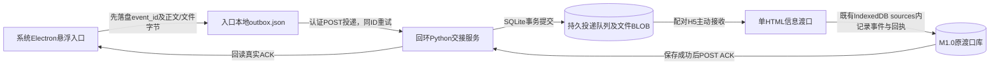

> 历史阶段记录；Windows最终结论以本包《Windows基础链路收尾报告》为准。

# M1.1 实际数据流与实施计划

## 进程与持久边界

Python只负责输入交接队列、文件缓存、回执和静态提供同一单HTML，不建人物/事项业务后端。Electron只维护本机待发送记录与窗口位置，不建人物库。H5是唯一业务接收端。内容可以复用，但事件ID不按正文hash生成；同ID不同载荷拒收。

## 授权边界

用户主动粘贴/选择/拖放文件是本轮真实可用输入。虚构消息按钮只生成虚构数据。微信指定范围抓取和无人值守采集均未获机制验证，不挂接原解密链。原服务无认证实现不再使用。

回环同源静态服务避免file://配对问题；H5与桌面使用不同随机凭证，校验Host、Origin/Fetch元数据和角色，撤权立即失效。凭证只落在当前用户runtime目录，不写日志或交付包。重启轮换凭证，队列不丢。

## 实施顺序

1. 先固定事件/回执契约、状态机及同ID冲突规则。
2. Python SQLite持久队列：认证、附件上限/格式校验、查询、ACK、模拟来源、撤权/关闭。
3. H5在既有sources上原子追加deliveryEvents与receipt；保存后才能ACK，重复事件复用原回执；保留独立事件身份。
4. Electron复用A最终版唯一SVG形象、窗口/拖动思路；剥离演示人物库、AI与归档，换为持久outbox和主进程HTTP交接。Renderer不暴露任意路径/HTTP/Node能力。
5. A–J隔离验收：网络/回执丢失、重启/离线、DOCX/PDF、同正文异事件、未授权网页、原M1功能回归。
6. 当前为macOS；尝试Electron真实窗口与浏览器闭环，Windows特性仍标待真机。交付中文包、Diff、日志与启动说明，到最小闭环即停止。
